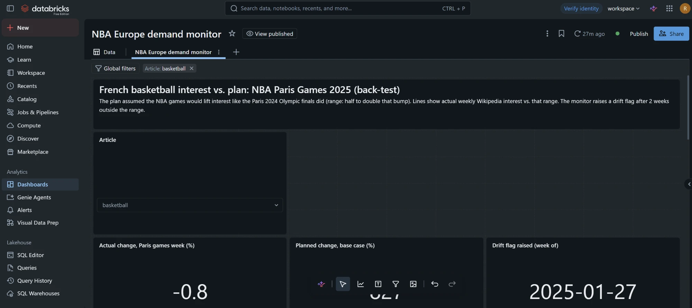
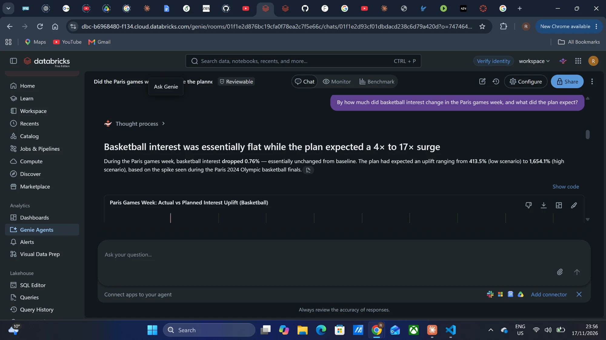
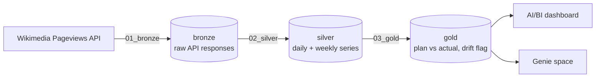

# NBA Europe demand monitor

**Does demand track the plan? A weekly monitor that compares a demand signal with the plan's range and flags drift, back-tested on a real event.**

## Result

The NBA Paris Games (January 2025) left French interest in basketball flat: **−0.8%** vs. normal. A plan based on the Paris 2024 Olympic basketball finals expected **+827%** (range +414% to +1,654%). The monitor flagged the miss in the second week (week of 27 January 2025). Interest in the NBA itself doubled (+100%), but that also stayed below its planned range.



## What it does

- Every Monday it pulls a demand signal (French Wikipedia interest in basketball and in the NBA), cleans it, and compares each week with the plan's low, base and high case.
- A week outside the range is a drift week. Two in a row raise a drift flag for the planner.
- Planners can ask questions in plain English. Answers were checked against the data before use: [5 tests, all passed](docs/genie_tests.md).

## What it means for planning

- A one-off NBA game moves attention to the league and its stars, not to basketball as a category. Planning a launch-season uplift on national-team-style spikes would badly overstock.
- This matches my earlier analysis ([NBA Europe demand plan](https://github.com/razvan-m-30/nba-europe-demand-plan)), which recommends a modest +6.5% to +13% category uplift for the 2027-28 launch. A monitor like this is how a planner would see early whether that plan is drifting.



**Limits.** Wikipedia interest is a proxy for demand, not sales. One market (France) and one past event were tested, and the outcome was already known from the earlier analysis; the rule was committed before any data was pulled, so it could not be tuned to fit.

---

## How it's built

A medallion pipeline on Databricks (Free Edition): raw data lands in bronze, is cleaned in silver, and is turned into plan-vs-actual results in gold. The dashboard and Genie read only from gold.



| Layer | Table (catalog `nba_demand`) | Contents |
|---|---|---|
| bronze | `bronze.api_responses` | Raw API responses as received, append-only, one batch per run |
| silver | `silver.pageviews_daily` | One row per article per day: gap fill, outlier flag (flagged, never overwritten), loaded with `MERGE` |
| silver | `silver.pageviews_weekly` | Complete Monday-start weeks, index 2019 = 100 |
| gold | `gold.forecast_rule` | Parameters of the pre-registered forecast rule |
| gold | `gold.forecast_vs_actual` | Per article per week: actual vs. planned low/base/high, band position, drift flag |
| gold | `gold.hindcast_summary` | One row per article: the headline result |

**Schedule.** A Databricks job runs `01_bronze` → `02_silver` → `03_gold` every Monday at 06:30 (Europe/Amsterdam) on serverless compute; each task runs only if the previous one succeeded, and failures send an email.

**The forecast rule (back-test).** The plan assumes the NBA Paris Games (week of 20 Jan 2025) lift interest the way the Paris 2024 Olympic finals did (week of 5 Aug 2024): the Olympic uplift over its 8-week baseline, week by week for 13 weeks, applied to the Paris baseline. Low and high are half and double that uplift. The full rule was committed before any data was pulled: see [docs/decision_log.md](docs/decision_log.md).

## How to run

1. In a Databricks workspace (Free Edition works): **Workspace → Create → Git folder** with this repo's URL.
2. Run `notebooks/00_setup` once: creates catalog `nba_demand` with schemas `bronze`, `silver`, `gold`, and tests access to the Wikimedia APIs.
3. Run `notebooks/01_bronze`, `02_silver`, `03_gold` in order, or create a job with those three as dependent tasks on a weekly schedule.
4. Dashboard and Genie space: built in the workspace on the gold tables; their queries and instructions are in [docs/dashboard.md](docs/dashboard.md) and [docs/genie_tests.md](docs/genie_tests.md).

## Repository layout

```
notebooks/            00_setup, 01_bronze, 02_silver, 03_gold (run in order)
src/                  collect_wikipedia.py: API client reused from the earlier project (imported by 01_bronze)
reference/project1/   unchanged copies of the earlier project's processing code, kept as the source for porting
docs/                 decision log (with the pre-registered rule), Genie test log, dashboard notes, images
```

## Limitations

- **Proxy, not sales.** Wikipedia pageviews measure attention, not purchases. A language edition is not a country.
- **One analog, one target, one market.** The back-test shows the method caught one real miss; it does not show the forecast is accurate in general.
- **Outcome known in advance.** The earlier project had already measured the Paris games. Committing the rule first guards against tuning, not against prior knowledge.
- **Later weeks are confounded by the calendar.** The Olympic baseline comes from June-July 2024 (a summer low for basketball, and inflated by the NBA Finals and draft for the NBA article), and the weeks after the finals run into the August holiday and the start of the NBA season. Verdicts for weeks 2-12 therefore mix event and seasonal effects; the headline uses the event week and the first flag. No control market or seasonality adjustment was used (time budget).
- **Overlapping events.** Both events are French and share a star (Victor Wembanyama played the Olympic final and plays for the Spurs); the Olympics also carry a national-team effect a club game doesn't.
- **Live monitoring.** Against the real 2027-28 plan, the monitor can only report "on baseline" until the launch; the drift logic is exercised in the back-test.
- **Genie** got all tested figures right but paraphrased two answers loosely (see the test log): read the numbers, not the summaries.

## Related

- Earlier analysis that this project builds on: [nba-europe-demand-plan](https://github.com/razvan-m-30/nba-europe-demand-plan)
